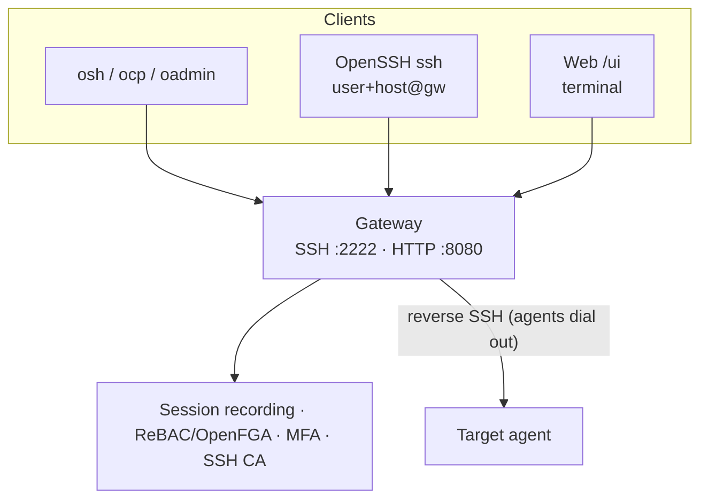

# Orion Belt

<p align="center">
  <picture>
    <source media="(prefers-color-scheme: dark)" srcset="assets/readme/orion-belt-header-dark.svg">
    
  </picture>
</p>

<p align="center">
  <a href="https://orion-belt.dev"></a>
  <a href="https://discord.gg/w62S8jxTHJ"></a>
  <a href="LICENSE"></a>
  <a href="go.mod"></a>
  <a href="https://github.com/orion-belt-dev/orion-belt/releases"></a>
  <a href="https://github.com/orion-belt-dev/orion-belt/actions"></a>
</p>

Agents dial out. Sessions are recorded. Access expires on its own.

Orion Belt is a self-hosted access gateway for SSH, RDP, VNC and Kubernetes, with privileged access management (PAM) workflows. Agents on your servers connect out to the gateway over reverse SSH, so targets need no inbound ports. The gateway adds session recording and live watch, just-in-time access with approvals, MFA and WebAuthn, relationship-based access control (ReBAC), and an optional SSH certificate authority.

> Version 1.4.0 is the current release. Orion Belt is free to self-host and use internally under [Apache 2.0 with the Commons Clause](LICENSE); it may not be sold as a product or hosted service. See [orion-belt.dev](https://orion-belt.dev) for details.

## Why Orion Belt

- Self-hosted, with no SaaS dependency.
- SSH, SCP, RDP, VNC and just-in-time Kubernetes access through the same agent tunnel.
- Agents connect out over reverse SSH, so target hosts need no inbound firewall rules.
- Every session is recorded and can be watched live.
- Just-in-time access with approvals from the console, the API, or chat (ChatOps).
- MFA with TOTP and WebAuthn.
- ReBAC authorization, optionally backed by OpenFGA.
- Optional SSH certificate authority.
- Linux packages for deb, rpm and apk distributions.

## Orion Belt in Action


## Try Orion Belt in 10 minutes

The quickstart brings up a gateway and a connected agent, opens a shell through
it, and records the session. It needs only Docker.

```bash
git clone https://github.com/orion-belt-dev/orion-belt.git
cd orion-belt
./scripts/docker-quickstart.sh
```

The script generates its own secrets, starts the gateway, creates your admin
user, registers a demo machine (`lab-1`), and prints a link that signs you in to
the console. Then, in the console:

1. Open **Machines**, select **lab-1**, open the web terminal, and run a few commands.
2. Open **Sessions** and select **Playback** to replay what you just did.

From a terminal instead: `./bin/osh -c client.yaml root@lab-1`

Stop everything with `./scripts/docker-quickstart.sh --down`.

For the full walkthrough, including an agent on a real machine, see
[Try Orion Belt in 10 minutes](docs/TRY_IN_10_MINUTES.md).

## Orion Belt vs alternatives

| | Orion Belt | Teleport | Boundary | Traditional bastion |
| --- | --- | --- | --- | --- |
| Scope | PAM / bastion for SSH, RDP/VNC and Kubernetes | Broad zero-trust platform | Credential brokering / sessions | Jump host |
| Deploy | Self-hosted, Linux-first | Self-hosted or cloud | Self-hosted or HCP | DIY |
| Target reach | Agents dial out (no inbound on hosts) | Node agents / reverse tunnels | Workers / proxies | Inbound to bastion, often to hosts too |
| Session recording | Yes, with live watch | Yes | Yes (with workers) | Usually custom or none |
| JIT approvals | Built in, with ChatOps | Yes | Via workflows / IdP | Rarely |
| Weight | Lighter SSH PAM slice | Large platform | Identity-centric | Minimal features |

Orion Belt fits teams that want to run their own access management for servers, desktops and clusters without exposing SSH, RDP or the Kubernetes API on every host or operating a platform the size of Teleport.

## Features

- **Gateway:** SSH and SCP proxy with recording, ReBAC, MFA and an optional SSH CA.
- **RDP and VNC:** `osh rdp` / `osh vnc` open a local port relayed through the agent; see [RDP_VNC.md](docs/RDP_VNC.md).
- **Kubernetes:** approved grants become time-limited RoleBindings, used through `osh kube`; see [KUBERNETES.md](docs/KUBERNETES.md).
- **Agents:** connect out over reverse SSH; targets need no inbound ports. Reload, drain and update them from the gateway ([AGENT_MANAGEMENT.md](docs/AGENT_MANAGEMENT.md)).
- **Clients:** `osh`, `ocp` and `oadmin`, or standard OpenSSH (`user+machine@gateway`).
- **Just-in-time access:** request, approve, and receive a time-limited grant from the console, the API, or Slack, Discord, Teams and Rocket.Chat.
- **Web console:** terminal, file browser, session playback and live watch, and management of users, machines and permissions.
- **Usage dashboard:** access volume, approval latency and most-used targets over a rolling window.
- **Compliance and risk:** SOC2, ISO 27001 and PCI reports (CSV/PDF/JSON), explain-access, risk-based auto-approve/escalate, anomaly flags; see [COMPLIANCE_REPORTS.md](docs/COMPLIANCE_REPORTS.md) and [RISK.md](docs/RISK.md).
- **Plugins:** audit logging, email, webhook and Slack notifications, and ChatOps approvals, configured from the console.
- **Operations:** Prometheus metrics, JSON logs, an OpenAPI specification, and GPG-signed deb/rpm plus RSA-signed apk repositories.

## Architecture



Details: [ARCHITECTURE.md](docs/ARCHITECTURE.md).

## Install

Signed packages live at **[pkgs.orion-belt.dev](https://pkgs.orion-belt.dev)**. The installer adds the apt / dnf / zypper / apk / pacman repo for your OS (or falls back to a verified release package). Docker remains the fastest lab path.

### Docker (lab)

```bash
git clone https://github.com/orion-belt-dev/orion-belt.git
cd orion-belt
./scripts/docker-quickstart.sh
```

`--images` pulls GHCR; `--from-source` builds here. Full walkthrough: [Try in 10 minutes](docs/TRY_IN_10_MINUTES.md). Production Compose: `cp .env.prod.example .env.prod && make docker-prod-up` (TLS: [REVERSE_PROXY.md](docs/REVERSE_PROXY.md)).

### One-liner (`install.sh`)

```bash
curl -fsSL https://pkgs.orion-belt.dev/install.sh | sh -s -- server   # gateway (Linux)
curl -fsSL https://pkgs.orion-belt.dev/install.sh | sh -s -- agent    # agent (Linux)
curl -fsSL https://pkgs.orion-belt.dev/install.sh | sh                # clients: osh, ocp, oadmin
```

```powershell
irm https://pkgs.orion-belt.dev/install.ps1 | iex                     # clients on Windows
scoop install https://pkgs.orion-belt.dev/scoop/orion-belt.json
```

`install.sh --help` covers `--version`, `--method`, `--prefix`, and `--uninstall`.

### Gateway — per OS (pkgs.orion-belt.dev)

Add the signed repo with the system package manager, install `orion-belt`, then configure and start. You need PostgreSQL reachable (or install it yourself). Set at least `database.connection_string`, `auth.jwt_secret`, and `server.public_url` in `/etc/orion-belt/server.yaml`.

<details>
<summary><b>Debian / Ubuntu</b> (apt)</summary>

```bash
curl -fsSLo /usr/share/keyrings/orion-belt.gpg https://pkgs.orion-belt.dev/orion-belt.gpg
echo 'deb [signed-by=/usr/share/keyrings/orion-belt.gpg] https://pkgs.orion-belt.dev stable main' \
  | sudo tee /etc/apt/sources.list.d/orion-belt.list
sudo apt update
sudo apt install orion-belt

sudoedit /etc/orion-belt/server.yaml
# database.connection_string, auth.jwt_secret, server.public_url
# (optional) server.public_ssh_host / public_ssh_port if agents dial a different host:port

sudo systemctl enable --now orion-belt-server
sudo -u orionbelt orion-belt-server -c /etc/orion-belt/server.yaml setup
```

</details>

<details>
<summary><b>RHEL / Rocky / AlmaLinux / CentOS</b> (dnf)</summary>

```bash
sudo curl -fsSLo /etc/yum.repos.d/orion-belt.repo https://pkgs.orion-belt.dev/orion-belt.repo
sudo dnf install orion-belt

sudoedit /etc/orion-belt/server.yaml
sudo systemctl enable --now orion-belt-server
sudo -u orionbelt orion-belt-server -c /etc/orion-belt/server.yaml setup
```

</details>

<details>
<summary><b>Fedora</b> (dnf)</summary>

```bash
sudo curl -fsSLo /etc/yum.repos.d/orion-belt.repo https://pkgs.orion-belt.dev/orion-belt.repo
sudo dnf install orion-belt

sudoedit /etc/orion-belt/server.yaml
sudo systemctl enable --now orion-belt-server
sudo -u orionbelt orion-belt-server -c /etc/orion-belt/server.yaml setup
```

</details>

<details>
<summary><b>openSUSE</b> (zypper)</summary>

```bash
sudo zypper addrepo https://pkgs.orion-belt.dev/orion-belt.repo
sudo zypper install orion-belt

sudoedit /etc/orion-belt/server.yaml
sudo systemctl enable --now orion-belt-server
sudo -u orionbelt orion-belt-server -c /etc/orion-belt/server.yaml setup
```

</details>

<details>
<summary><b>Alpine</b> (apk, OpenRC)</summary>

```bash
sudo wget -O /etc/apk/keys/orion-belt.rsa.pub https://pkgs.orion-belt.dev/apk/orion-belt.rsa.pub
echo 'https://pkgs.orion-belt.dev/apk' | sudo tee -a /etc/apk/repositories
sudo apk update
sudo apk add orion-belt

sudoedit /etc/orion-belt/server.yaml
sudo rc-update add orion-belt-server default
sudo rc-service orion-belt-server start
sudo -u orionbelt orion-belt-server -c /etc/orion-belt/server.yaml setup
```

Without a signed APKINDEX (no `APK_RSA_PRIVATE_KEY` on the release), `install.sh` falls back to verified release files instead of an unsigned index.

</details>

<details>
<summary><b>Arch Linux</b> (pacman)</summary>

```bash
curl -fsSL https://pkgs.orion-belt.dev/orion-belt.asc | sudo pacman-key --add -
sudo pacman-key --lsign-key F1E47F7B036D5202262E174F613B2217A8958DA9
# add [orion-belt] with Server = https://pkgs.orion-belt.dev/archlinux/$arch to pacman.conf
sudo pacman -Sy orion-belt

sudoedit /etc/orion-belt/server.yaml
sudo systemctl enable --now orion-belt-server
sudo -u orionbelt orion-belt-server -c /etc/orion-belt/server.yaml setup
```

</details>

Console: `<public_url>/ui`. Confirm: `curl -s http://127.0.0.1:8080/api/v1/version`. More: [SETUP.md](docs/SETUP.md), [PACKAGING.md](docs/PACKAGING.md).

### Agent — enroll target hosts

Agents dial **out** to the gateway on SSH port **2222** (no inbound hole on the target).

**Recommended:** sign in as admin/operator → **Add agent** → pick OS → package base `https://pkgs.orion-belt.dev` → **Generate install script** → run as root on the target. The script installs the package, writes config + key, and starts the service. Treat it as a secret.

**Manual** — add the same pkgs.orion-belt.dev repo as for the gateway (see above), then install and configure:

<details>
<summary><b>Debian / Ubuntu</b></summary>

```bash
# repo already added (orion-belt.list) — otherwise use the Gateway block above
sudo apt update
sudo apt install orion-belt-agent

sudoedit /etc/orion-belt/agent.yaml
# server.host: orion.example.com
# server.port: 2222
# agent.name: web-01
# auth.key_file: /etc/orion-belt/agent_key

sudo ssh-keygen -t ed25519 -f /etc/orion-belt/agent_key -N ""
# Register agent_key.pub with the gateway (UI, oadmin, or POST /api/v1/public/register/agent)

sudo systemctl enable --now orion-belt-agent
```

</details>

<details>
<summary><b>RHEL / Rocky / AlmaLinux / CentOS</b></summary>

```bash
sudo curl -fsSLo /etc/yum.repos.d/orion-belt.repo https://pkgs.orion-belt.dev/orion-belt.repo
sudo dnf install orion-belt-agent

sudoedit /etc/orion-belt/agent.yaml
# server.host / port 2222 / agent.name / auth.key_file as above

sudo ssh-keygen -t ed25519 -f /etc/orion-belt/agent_key -N ""
# Register agent_key.pub with the gateway

sudo systemctl enable --now orion-belt-agent
```

</details>

<details>
<summary><b>Fedora</b></summary>

```bash
sudo curl -fsSLo /etc/yum.repos.d/orion-belt.repo https://pkgs.orion-belt.dev/orion-belt.repo
sudo dnf install orion-belt-agent

sudoedit /etc/orion-belt/agent.yaml
sudo ssh-keygen -t ed25519 -f /etc/orion-belt/agent_key -N ""
# Register agent_key.pub with the gateway

sudo systemctl enable --now orion-belt-agent
```

</details>

<details>
<summary><b>openSUSE</b></summary>

```bash
sudo zypper addrepo https://pkgs.orion-belt.dev/orion-belt.repo
sudo zypper install orion-belt-agent

sudoedit /etc/orion-belt/agent.yaml
sudo ssh-keygen -t ed25519 -f /etc/orion-belt/agent_key -N ""
# Register agent_key.pub with the gateway

sudo systemctl enable --now orion-belt-agent
```

</details>

<details>
<summary><b>Alpine</b></summary>

```bash
sudo wget -O /etc/apk/keys/orion-belt.rsa.pub https://pkgs.orion-belt.dev/apk/orion-belt.rsa.pub
echo 'https://pkgs.orion-belt.dev/apk' | sudo tee -a /etc/apk/repositories
sudo apk update
sudo apk add orion-belt-agent

sudoedit /etc/orion-belt/agent.yaml
sudo ssh-keygen -t ed25519 -f /etc/orion-belt/agent_key -N ""
# Register agent_key.pub with the gateway

sudo rc-update add orion-belt-agent default
sudo rc-service orion-belt-agent start
```

</details>

<details>
<summary><b>Arch Linux</b></summary>

```bash
# repo already configured (see Gateway Arch block), then:
sudo pacman -Sy orion-belt-agent

sudoedit /etc/orion-belt/agent.yaml
sudo ssh-keygen -t ed25519 -f /etc/orion-belt/agent_key -N ""
# Register agent_key.pub with the gateway

sudo systemctl enable --now orion-belt-agent
```

</details>

<details>
<summary><b>install.sh</b> (any supported Linux)</summary>

```bash
curl -fsSL https://pkgs.orion-belt.dev/install.sh | sh -s -- agent
# then edit /etc/orion-belt/agent.yaml, register the key, and start the service
```

</details>

Connected agents appear under **Agents** / **Machines** in the console. Details: [SETUP.md — Add agents](docs/SETUP.md#3-add-agents).

### Clients — `osh` / `ocp` / `oadmin`

Plain OpenSSH works (`ssh -p 2222 user+machine@gateway`). The tools package adds console login, file copy, JIT requests and admin commands.

<details>
<summary><b>Debian / Ubuntu</b></summary>

```bash
curl -fsSLo /usr/share/keyrings/orion-belt.gpg https://pkgs.orion-belt.dev/orion-belt.gpg
echo 'deb [signed-by=/usr/share/keyrings/orion-belt.gpg] https://pkgs.orion-belt.dev stable main' \
  | sudo tee /etc/apt/sources.list.d/orion-belt.list
sudo apt update
sudo apt install orion-belt-tools
```

</details>

<details>
<summary><b>RHEL / Rocky / AlmaLinux / CentOS</b></summary>

```bash
sudo curl -fsSLo /etc/yum.repos.d/orion-belt.repo https://pkgs.orion-belt.dev/orion-belt.repo
sudo dnf install orion-belt-tools
```

</details>

<details>
<summary><b>Fedora</b></summary>

```bash
sudo curl -fsSLo /etc/yum.repos.d/orion-belt.repo https://pkgs.orion-belt.dev/orion-belt.repo
sudo dnf install orion-belt-tools
```

</details>

<details>
<summary><b>openSUSE</b></summary>

```bash
sudo zypper addrepo https://pkgs.orion-belt.dev/orion-belt.repo
sudo zypper install orion-belt-tools
```

</details>

<details>
<summary><b>Alpine</b></summary>

```bash
sudo wget -O /etc/apk/keys/orion-belt.rsa.pub https://pkgs.orion-belt.dev/apk/orion-belt.rsa.pub
echo 'https://pkgs.orion-belt.dev/apk' | sudo tee -a /etc/apk/repositories
sudo apk update
sudo apk add orion-belt-tools
```

</details>

<details>
<summary><b>Arch Linux</b></summary>

```bash
# after the Gateway Arch repo setup:
sudo pacman -Sy orion-belt-tools
```

</details>

<details>
<summary><b>macOS / BSD / other</b> (`install.sh`)</summary>

```bash
curl -fsSL https://pkgs.orion-belt.dev/install.sh | sh
# installs osh, ocp, oadmin under /usr/local by default (--prefix to change)
```

</details>

<details>
<summary><b>Windows</b></summary>

```powershell
irm https://pkgs.orion-belt.dev/install.ps1 | iex
# or: scoop install https://pkgs.orion-belt.dev/scoop/orion-belt.json
```

</details>

First run writes `~/.orion-belt/client.yaml` (or pass `-c`). Examples (gateway `orion.example.com`, machine `web-01`, user `alice`):

```bash
osh login                          # browser sign-in via SSH key
osh --list
osh alice@web-01                   # recorded shell through the gateway
ocp ./file web-01:/tmp/file
oadmin requests list

# Plain OpenSSH (no tools package):
ssh -p 2222 'alice+web-01@orion.example.com'
```

More: [CLIENT-CLI.md](docs/CLIENT-CLI.md), [openssh-clients.md](docs/openssh-clients.md).

### From source

```bash
git clone https://github.com/orion-belt-dev/orion-belt.git
cd orion-belt
make build   # Go 1.27.3+ (see go.mod)
```

Local packages: `make packages` → install from `dist/` ([PACKAGING.md](docs/PACKAGING.md)).

## Docs

| Doc | |
| --- | --- |
| [Try in 10 minutes](docs/TRY_IN_10_MINUTES.md) | Lab path to first recorded session |
| [SETUP.md](docs/SETUP.md) | Production / package first-run |
| [SSH_CA.md](docs/SSH_CA.md) | Optional certificate authority |
| [RDP_VNC.md](docs/RDP_VNC.md) | RDP and VNC through the agent tunnel |
| [KUBERNETES.md](docs/KUBERNETES.md) | Just-in-time Kubernetes access |
| [AGENT_MANAGEMENT.md](docs/AGENT_MANAGEMENT.md) | Reload, drain and update agents |
| [COMPLIANCE_REPORTS.md](docs/COMPLIANCE_REPORTS.md) | SOC2 / ISO 27001 / PCI reports |
| [GO_SDK.md](docs/GO_SDK.md) | Reusable Go SDK for API integrations |
| [MULTI_LANGUAGE_SDK.md](docs/MULTI_LANGUAGE_SDK.md) | Python / .NET / JS SDK plan |
| [openssh-clients.md](docs/openssh-clients.md) | Vanilla `ssh` via the gateway |
| [DEPLOYMENT_HARDENING.md](docs/DEPLOYMENT_HARDENING.md) | Hardening checklist |
| [REVERSE_PROXY.md](docs/REVERSE_PROXY.md) | TLS with nginx or Caddy, trusted proxies |
| [OBSERVABILITY.md](docs/OBSERVABILITY.md) | Metrics and logging |
| [BENCHMARKS.md](docs/BENCHMARKS.md) | Session and throughput benchmarks, performance gate |
| [OpenAPI](docs/openapi/openapi.yaml) | HTTP/WS API |
| [ROADMAP.md](docs/ROADMAP.md) | Planned work (OIDC, secrets vault, DB gateway, HA and more) |

## Security

- All connections use SSH. Recordings can be encrypted at rest with AES-GCM.
- ReBAC, optionally backed by OpenFGA, controls access to each machine and remote account.
- MFA supports TOTP and WebAuthn, and SSH logins accept FIDO `sk-*` keys.
- Temporary access expires automatically. The audit log records access and configuration changes.
- There is no open signup. Accounts are created by an admin or operator; only the very first account on a new install can be created without signing in.
- Plain users see only their own sessions, requests, grants and account details.

## License

Apache License 2.0 with the [Commons Clause](https://commonsclause.com/). See [LICENSE](LICENSE).

You may use, modify, and run Orion Belt internally (including commercially). The Clause withholds selling Orion Belt itself, or a hosted service whose value derives substantially from it, as a product.

## Contributing

Issues and pull requests are welcome. See [CONTRIBUTING.md](docs/CONTRIBUTING.md).

If you run Orion Belt in a lab or a small team and are willing to share feedback, join [Discord](https://discord.gg/w62S8jxTHJ), start a [discussion](https://github.com/orion-belt-dev/orion-belt/discussions), or open an issue.
