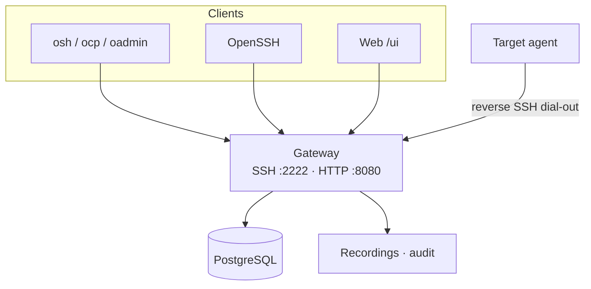

# Architecture overview

Orion Belt is a **self-hosted SSH access gateway** with PAM-style workflows.

## Components

1. **Gateway (server)** — SSH/SCP proxy (:2222), HTTP API + web console (:8080), ReBAC, MFA, recording, optional SSH CA  
2. **Agents** — on targets; dial **out** with reverse SSH (no inbound hole required on the host)  
3. **Clients** — web terminal, OpenSSH (`user+machine@gateway`), or `osh` / `ocp` / `oadmin`

## Trust boundary

- Operators and agents both connect **to** the gateway
- The gateway brokers sessions and can record / live-watch them
- Direct SSH to an agent host bypasses policy and recording

## Related

- [Sequence diagrams](./sequence-diagrams)
- [Component diagrams](./component-diagrams)
- [Try in 10 minutes](../quickstart/try-in-10-minutes)
