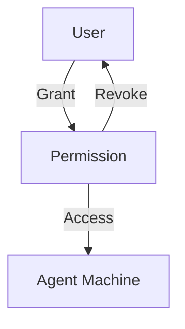

# Permissions Management

Permissions control which users can access which machines and with what type of access.

---

## 1. Grant Access

```bash
orion-belt-server permission grant \
  --user alice \
  --machine web-01 \
  --type ssh \
  --duration 3600
```

* `--type` → `ssh`, `scp`, or `both`
* `--duration` → Optional, in seconds

---

## 2. List Permissions

```bash
orion-belt-server permission list alice
```

**Output:**

| MACHINE | ACCESS TYPE | GRANTED AT          | EXPIRES             |
| ------- | ----------- | ------------------- | ------------------- |
| web-01  | ssh         | 2026-01-09 10:00:00 | 2026-01-09 11:00:00 |

---

## 3. Revoke Permission

```bash
orion-belt-server permission revoke \
  --user alice \
  --machine web-01
```

---

## 4. Mermaid Diagram



---

## 5. FAQ

**Q: Can a permission be permanent?**
Yes, omit the `--duration` flag.

**Q: Can I grant temporary access to multiple machines at once?**
Yes, run multiple grant commands or use scripts.
