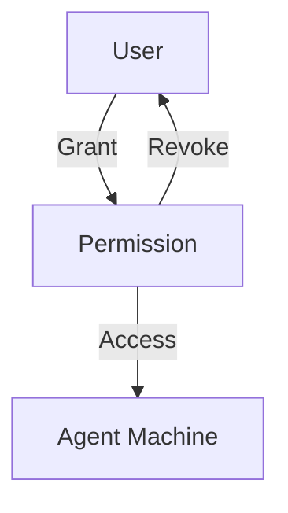

# Permissions Management

Permissions control which users can access which machines and with what type of access.

---

## 1. Grant Access

```bash
orion-belt-server permission grant \
  --user alice \
  --machine web-01 \
  --type ssh \
  --duration 3600
```

* `--type` → `ssh`, `scp`, `both`, `rdp`, `vnc` or `k8s`
* `--duration` → Optional, in seconds

| Access type | Covers | Remote users |
| --- | --- | --- |
| `ssh`, `scp` | That protocol | Target accounts, e.g. `root` |
| `both` | `ssh` and `scp` only | Target accounts |
| `rdp`, `vnc` (1.4.0) | That protocol, through the agent tunnel — see [RDP and VNC](./rdp-vnc) | None: the target handles the login |
| `k8s` (1.4.0) | Kubernetes, through an in-cluster agent — see [Kubernetes](./kubernetes) | Scopes, `namespace/role` or `*/role` |

:::warning[Changed in 1.4.0]
Before 1.4.0 the permission check matched a `both` grant for any access type.
`both` now covers `ssh` and `scp` only, so existing grants never widen to
RDP, VNC or Kubernetes. Nothing changes for SSH or SCP.
:::

---

## 2. List Permissions

```bash
orion-belt-server permission list alice
```

**Output:**

| MACHINE | ACCESS TYPE | GRANTED AT          | EXPIRES             |
| ------- | ----------- | ------------------- | ------------------- |
| web-01  | ssh         | 2026-01-09 10:00:00 | 2026-01-09 11:00:00 |

---

## 3. Revoke Permission

```bash
orion-belt-server permission revoke \
  --user alice \
  --machine web-01
```

---

## 4. Mermaid Diagram



---

## 5. FAQ

**Q: Can a permission be permanent?**
Yes, omit the `--duration` flag.

**Q: Can I grant temporary access to multiple machines at once?**
Yes, run multiple grant commands or use scripts.
