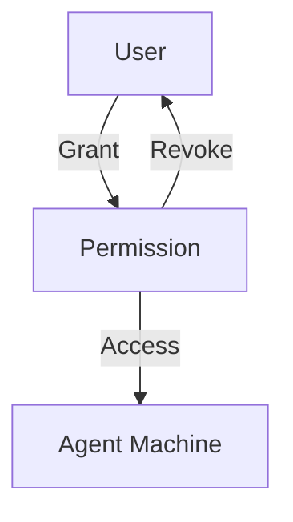

# Permissions Management

Permissions control which users can access which machines and with what type of access.

---

## 1. Grant Access

```bash
orion-belt-server permission grant \
  --user alice \
  --machine web-01 \
  --type ssh \
  --duration 3600
```

* `--type` → `ssh`, `scp`, `both`, `rdp`, `vnc` or `k8s`
* `--duration` → Optional, in seconds

| Access type | Covers | Remote users |
| --- | --- | --- |
| `ssh`, `scp` | That protocol | Target accounts, e.g. `root` |
| `both` | `ssh` and `scp` only | Target accounts |
| `rdp`, `vnc` (1.4.0) | That protocol, through the agent tunnel — see [RDP and VNC](./rdp-vnc) | None: the target handles the login |
| `k8s` (1.4.0) | Kubernetes, through an in-cluster agent — see [Kubernetes](./kubernetes) | Scopes, `namespace/role` or `*/role` |

:::warning[Changed in 1.4.0]
Before 1.4.0 the permission check matched a `both` grant for any access type.
`both` now covers `ssh` and `scp` only, so existing grants never widen to
RDP, VNC or Kubernetes. Nothing changes for SSH or SCP.
:::

---

## 2. List Permissions

```bash
orion-belt-server permission list alice
```

**Output:**

| MACHINE | ACCESS TYPE | GRANTED AT          | EXPIRES             |
| ------- | ----------- | ------------------- | ------------------- |
| web-01  | ssh         | 2026-01-09 10:00:00 | 2026-01-09 11:00:00 |

---

## 3. Revoke Permission

```bash
orion-belt-server permission revoke \
  --user alice \
  --machine web-01
```

---

## 4. Grant or revoke many at once

:::info[After 1.4.0]
Ships in the next release; not in 1.4.0.
:::

One call grants an access type to every user × machine pair, up to 500
grants:

```bash
oadmin permissions bulk-grant --user alice --user bob \
  --machine web-01 --machine web-02 \
  --access-type ssh --remote-user deploy --duration 3600

oadmin permissions bulk-revoke <permission-id> <permission-id> …
```

Each grant and revoke is audited on its own, and `k8s` grants trigger a
Kubernetes reconcile. In the console (**Permissions**), pick users and
machines from the filterable checkbox lists and submit once; to revoke,
select rows in the grant list and revoke them together.

The API equivalents are `POST /api/v1/admin/permissions/bulk` and
`POST /api/v1/admin/permissions/bulk-revoke`.

---

## 5. Effective access

What someone can actually do, after roles and grants are resolved:

```bash
oadmin permissions effective --user alice     # every machine alice can reach
oadmin permissions effective --machine web-01 # everyone who can reach web-01
```

Each row shows the access types (`both` expanded to `ssh` and `scp`), remote
users or Kubernetes scopes, expiry, and where the access comes from: a role
or a grant. The console shows the same under **Permissions → Effective
access**; the API is `GET /api/v1/admin/permissions/effective`.

---

## 6. Search grants

The grant list filters and pages on the server: `q` (text), `access_type`,
`user_id` and `machine_id` on `GET /api/v1/admin/permissions`, with the total
in the `X-Total-Count` header. Earlier releases loaded at most 2000 grants
and dropped the rest without saying so.

---

## 7. Mermaid Diagram



---

## 8. FAQ

**Q: Can a permission be permanent?**
Yes, omit the `--duration` flag.

**Q: Can I grant temporary access to multiple machines at once?**
Yes. From the next release, use `oadmin permissions bulk-grant` or the
console's multi-select (see [section 4](#4-grant-or-revoke-many-at-once)); on
1.4.0, run one grant command per pair.
