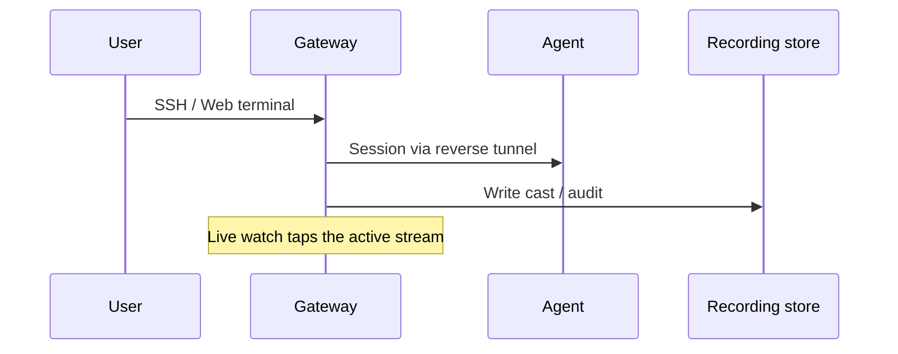

# Session recording & live watch

Every session that goes through the gateway can be recorded and replayed. Direct SSH to an agent host **bypasses** Orion — no recording.

## Enable / configure

In `server.yaml` (shape — see `config/server.example.yaml` in the main repo):

```yaml
recording:
  enabled: true
  storage_path: "/var/lib/orion-belt/recordings"
  compression: gzip          # or none
  retention_days: 90
  encryption_key: ""         # set for AES-GCM at rest in production
```

Docker quickstart enables recording by default; set `ORION_RECORDING_ENCRYPTION_KEY` in `.env.server` for at-rest encryption.

## View in the console

1. Open **Sessions**
2. Pick a session → **playback** (seek / play / pause)
3. For an active session → **live watch**

Web terminal sessions are recorded (`source=web`, `.cast`) the same way as SSH/CLI sessions.

## CLI (optional)

```bash
orion-belt-server session list
# live watch helpers exist in the product CLI — prefer the UI for day-to-day
```

## Flow



## FAQ

**How long are recordings kept?**  
`recording.retention_days` — the retention loop deletes older files.

**Can I turn recording off?**  
Yes (`recording.enabled: false`) — not recommended for production PAM use.

**Where are files stored?**  
Default `/var/lib/orion-belt/recordings` (Docker volume `orion_recordings` in the compose stack).

**Who can replay?**  
Controlled by role / permissions in the console — treat recordings as sensitive.
