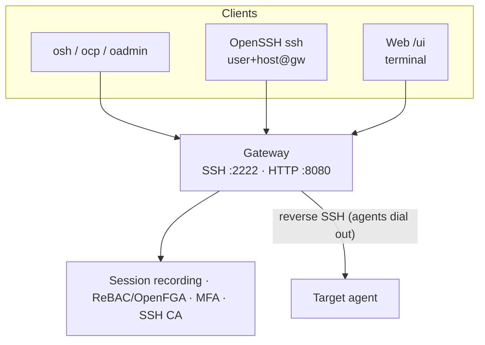

# Orion Belt Documentation

**Orion Belt** is a self-hosted SSH access gateway with PAM workflows.

Teleport-like SSH access control — without opening inbound ports or adopting a large platform. Agents dial **out** over reverse SSH; you get session recording, live watch, JIT approvals, MFA/WebAuthn, ReBAC, and optional SSH CA.

:::tip[v1.3.0]
Stable and public. Fastest path: **[Try Orion Belt in 10 minutes](./quickstart/try-in-10-minutes)** (Docker with GHCR images or build-from-source). Linux servers can also use the **curl|bash** installer — see [Installation](./quickstart/installation).
New in 1.3.0: run [Ansible and AWX through the gateway](./automation/ansible-awx) with no wrapper script, and `ssh -t` for one-shot commands.
:::

> Free to self-host and use internally under [Apache 2.0 + Commons Clause](https://github.com/orion-belt-dev/orion-belt/blob/master/LICENSE). You cannot sell Orion Belt as a product or hosted service.

## Why Orion Belt?

| | |
| --- | --- |
| ✓ | Self-hosted — no SaaS dependency |
| ✓ | Reverse SSH agents — no inbound firewall holes on targets |
| ✓ | Session recording + live watch |
| ✓ | JIT access with approvals (UI / API / ChatOps) |
| ✓ | MFA — TOTP + WebAuthn |
| ✓ | ReBAC authorization (optional OpenFGA) |
| ✓ | Optional SSH Certificate Authority |
| ✓ | Linux packages (deb / rpm / apk) |

## Architecture

## How it works

1. **Gateway (server)** — control plane: authn/authz, recording, API, web console
2. **Agent** — on each target; dials out to the gateway (no inbound SSH required on the host)
3. **Clients** — `osh` / `ocp` / `oadmin`, vanilla OpenSSH, or the web terminal

## Who it’s for

- DevOps / SRE / Linux admins who need mediated SSH
- Homelab / self-hosting users who want recording + approvals without SaaS
- Small teams that need privileged SSH access without a full multi-protocol platform

## Getting started

1. **[Try in 10 minutes](./quickstart/try-in-10-minutes)** — Docker quickstart to first recorded session  
2. [Installation](./quickstart/installation) — packages / source  
3. [Server setup](./quickstart/server) · [Agent](./quickstart/agent) · [Client](./quickstart/client)

## Community

- [Discord](https://discord.gg/w62S8jxTHJ)
- [GitHub](https://github.com/orion-belt-dev/orion-belt)
- [Discussions](https://github.com/orion-belt-dev/orion-belt/discussions) — looking for early operators
