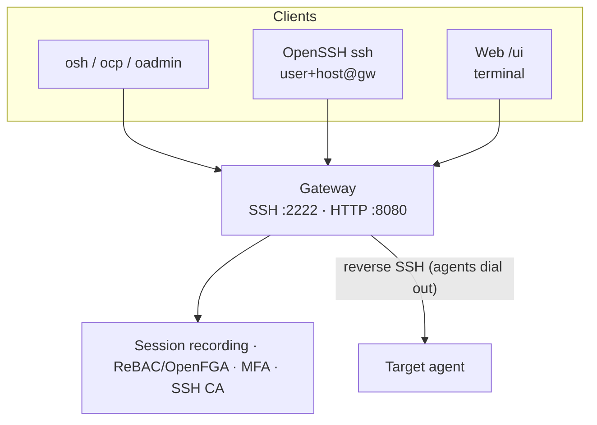

# Orion Belt Documentation

**Orion Belt** is a self-hosted SSH access gateway with PAM workflows.

Teleport-like SSH access control — without opening inbound ports or adopting a large platform. Agents dial **out** over reverse SSH; you get session recording, live watch, JIT approvals, MFA/WebAuthn, ReBAC, and optional SSH CA.

:::tip[v1.5.0]
Stable and public. Fastest path: **[Get started in 10 minutes](./quickstart/get-started)**, from the signed packages, step by step for your OS. To only look around, [try it with Docker](./quickstart/try-in-10-minutes). Every option: [Installation](./quickstart/installation).
New in 1.5.0: [Python and TypeScript SDKs](./api/sdks.md) for the whole API, [agent remote management](./guides/agent-management), [bulk grants and effective access](./guides/permissions-management#4-grant-or-revoke-many-at-once), tunnels that survive network drops, [standard API error codes](./api/index.md#errors), the 2026-11 security audit fixes, and [verifiable build provenance](./quickstart/verify-release). Orion Belt is now open source under the AGPL v3.0.
:::

> Open source under the [GNU AGPL v3.0](https://github.com/orion-belt-dev/orion-belt/blob/master/LICENSE). Free to use, self-host, modify and run commercially. If you distribute Orion Belt, or offer a modified version over a network, you publish your source under the same license.

## Why Orion Belt?

| | |
| --- | --- |
| ✓ | Self-hosted — no SaaS dependency |
| ✓ | Reverse SSH agents — no inbound firewall holes on targets |
| ✓ | Session recording + live watch |
| ✓ | JIT access with approvals (UI / API / ChatOps) |
| ✓ | MFA — TOTP + WebAuthn |
| ✓ | ReBAC authorization (optional OpenFGA) |
| ✓ | Optional SSH Certificate Authority |
| ✓ | Linux packages (deb / rpm / apk / pacman) |
| ✓ | Python, TypeScript and Go SDKs |
| ✓ | Open source (AGPL v3.0), signed releases with SLSA provenance |

## Architecture

## How it works

1. **Gateway (server)** — control plane: authn/authz, recording, API, web console
2. **Agent** — on each target; dials out to the gateway (no inbound SSH required on the host)
3. **Clients** — `osh` / `ocp` / `oadmin`, vanilla OpenSSH, or the web terminal

## Who it’s for

- DevOps / SRE / Linux admins who need mediated SSH
- Homelab / self-hosting users who want recording + approvals without SaaS
- Small teams that need privileged SSH access without a full multi-protocol platform

## Getting started

1. **[Get started in 10 minutes](./quickstart/get-started)** — install, configure and run the server, the clients and an agent, per OS  
2. [Try it with Docker](./quickstart/try-in-10-minutes) — throwaway demo to a first recorded session  
3. [Installation](./quickstart/installation) — every install method, including from source  
4. [Server setup](./quickstart/server) · [Agent](./quickstart/agent) · [Client](./quickstart/client)

## Community

- [Discord](https://discord.gg/w62S8jxTHJ)
- [GitHub](https://github.com/orion-belt-dev/orion-belt)
- [Discussions](https://github.com/orion-belt-dev/orion-belt/discussions) — looking for early operators
