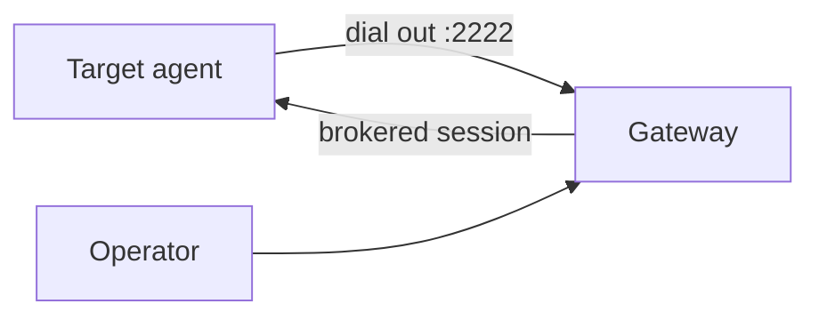

# Agent setup

Agents run on machines you want to reach. Each agent dials **out** to the gateway over reverse SSH — **no inbound firewall hole** on the target for Orion.



:::tip Recommended
In the web console: **Add agent** → generate install script → run as root on the target. That registers the agent, embeds the key, installs the package, and starts the service.
:::

## Lab — Docker agent

[Try in 10 minutes](./try-in-10-minutes) already connects a demo machine
(`lab-1`). Use this section when you skipped the demo
(`./scripts/docker-quickstart.sh --no-agent`) or want a second agent on another
host.

1. Console → **Add agent** → name e.g. `lab-2` → save private key as `./agent-key` (`chmod 600`)
2. Configure and start:

```bash
cp .env.agent.example .env.agent
# ORION_AGENT_NAME=lab-2  (must match registration)
# ORION_SERVER_HOST=host.docker.internal  # or LAN IP of the gateway host
docker compose -f docker-compose.agent.yml --env-file .env.agent up -d
```

Confirm status under **Machines** in the UI.

## Production — UI install script

1. Sign in as **admin** or **operator**
2. **Add agent** → pick OS → set agent name, gateway host (SSH **2222**), package base URL
   (default: `https://pkgs.orion-belt.dev`)
3. **Generate install script** → run on the target as root

API: `POST /api/v1/admin/agents/install-script` (see OpenAPI in the main repo).

## Production — manual

1. Install `orion-belt-agent` (packages —
   [pkgs.orion-belt.dev](https://pkgs.orion-belt.dev) or main repo `docs/PACKAGING.md`)
2. Edit `/etc/orion-belt/agent.yaml` — gateway host + port **2222**
3. Key + register:
   - `ssh-keygen -t ed25519 -f /etc/orion-belt/agent_key -N ""`
   - Register the **public** key via UI, `POST /api/v1/public/register/agent`, or `orion-belt-server agent register`
   - With **SSH CA** enabled: registration may return a Host cert — see main repo `docs/SSH_CA.md`
4. `systemctl enable --now orion-belt-agent`

Example `agent.yaml` shape:

```yaml
server:
  host: "orion.example.com"
  port: 2222

agent:
  name: "web-01"
  tags:
    - "production"
    - "web"

auth:
  key_file: "/etc/orion-belt/agent_key"
```

## Keys

| Where | Key |
| --- | --- |
| Agent host | **Private** key (`agent_key`) |
| Gateway / registration | **Public** key only |

## FAQ

**Does the gateway SSH into the agent on port 22?**  
No. The agent opens an outbound tunnel to the gateway. Old docs that talked about `--hostname` / inbound `:22` described a different model — ignore that for v1.

**Do I need a Linux user matching every Orion username?**  
Sessions land as a configured **remote user** on the agent (e.g. `root` or `ubuntu`) via grants — not “one Linux account per Orion user” as a hard rule. Create the remote users you grant.

## Next

[Client setup](./client) · [Initial connection](./initial-connection)
