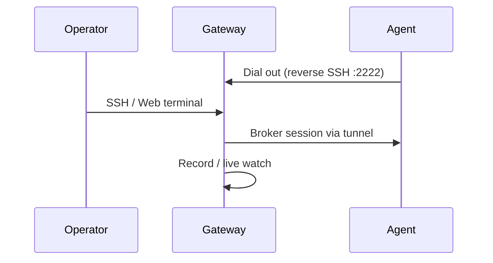

# Initial connection checklist

End-to-end path for v1: gateway up → agent dials out → grant → SSH → recording.



## 1. Gateway healthy

```bash
curl -sf http://localhost:8080/health
curl -s http://localhost:8080/api/v1/version
```

Admin can sign in at `/ui`.

## 2. Register + start agent

**Preferred:** console **Add agent** → install script or Docker agent ([Agent setup](./agent)).

Confirm the agent shows **connected** under **Machines**.

:::warning Reverse tunnel
The gateway does **not** need a route to the agent’s port 22. If the agent can reach the gateway on **2222**, you’re good.
:::

## 3. Grant access

In **Users** / **Permissions**, grant your user the machine and a remote user (e.g. `root`), or:

```bash
orion-belt-server permission grant \
  --user admin --machine lab-1 --type both --remote-users root
```

## 4. Connect

- Web **Terminal**, or
- `ssh -p 2222 admin+lab-1@<gateway-host>`, or
- `osh lab-1`

Run a few commands.

## 5. Verify recording

**Sessions** → open the session → **playback** (or **live watch** while active).

## Troubleshooting

| Symptom | Likely cause |
| --- | --- |
| Agent offline | Wrong `ORION_SERVER_HOST` / port; firewall blocks **outbound** 2222 from agent; bad `agent-key` |
| Can’t log into UI | Using private key instead of **public** key; admin not bootstrapped (`setup`) |
| Connect but empty machine list | Missing permission grant |
| No recording | Session didn’t go through the gateway; recording disabled in config |

## Next

- [Session recording](../guides/sessions)
- [Security practices](../guides/security)
- [Discord](https://discord.gg/w62S8jxTHJ) if you’re stuck
