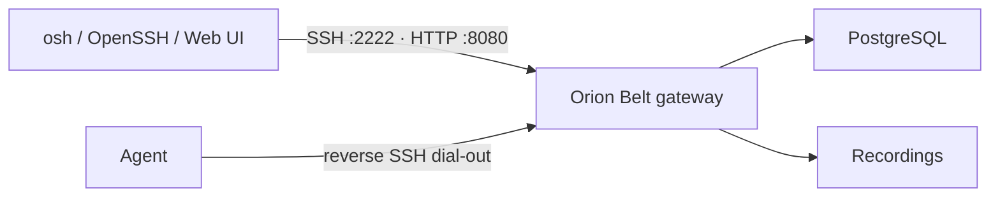

# Server (gateway) setup

The **Orion Belt server** is the control plane: SSH/SCP proxy, HTTP API, web console, authz, recording, and agent tunnels.

:::tip Lab first?
Use **[Try in 10 minutes](./try-in-10-minutes)** (`./scripts/docker-quickstart.sh`). This page covers durable / production-shaped setups.
:::



## Option A — Docker lab

From a clone of [orion-belt](https://github.com/orion-belt-dev/orion-belt):

```bash
./scripts/docker-quickstart.sh --images        # recommended
# or: ./scripts/docker-quickstart.sh --from-source
# or manually:
cp .env.server.example .env.server
# set POSTGRES_PASSWORD and ORION_JWT_SECRET (openssl rand -hex 32)
docker compose -f docker-compose.server.yml --env-file .env.server up -d
```

Ports:

| Port | Role |
| --- | --- |
| **2222** | SSH gateway (clients + agents) |
| **8080** | HTTP API + web console `/ui` |

The quickstart prints a one-time bootstrap link. Or run
`./bin/osh -c client.yaml login`, then set a password + TOTP.

Optional env (see `.env.server.example`): `ORION_WEBAUTHN_ENABLED`, public URL /
origin settings, `ORION_RECORDING_ENCRYPTION_KEY`, `ORION_MFA_REQUIRED`.

## Option B — Production Docker (GHCR images)

```bash
cp .env.prod.example .env.prod
# POSTGRES_PASSWORD, ORION_JWT_SECRET, public URL (ORION_PUBLIC_URL / host+origin)
# optional: ORION_IMAGE_TAG=1.4.0  (default :latest)
make docker-prod-up
# or: docker compose -f docker-compose.prod.yml --env-file .env.prod pull && up -d
```

Images: `ghcr.io/orion-belt-dev/orion-belt-server` (and agent via
`docker-compose.prod.agent.yml` / `make docker-prod-agent-up`).

## Option C — curl | bash installer

```bash
curl -fsSL https://raw.githubusercontent.com/orion-belt-dev/orion-belt/master/scripts/install-server.sh | sudo bash
```

Writes `/etc/orion-belt/server.yaml` (including **public URL**), enables the
service, and runs setup. Details and unattended flags:
[Installation](./installation#curl--bash-linux-server).

## Option D — Packages / systemd

1. Install the `orion-belt` package (deb/rpm/apk — public mirror
   [pkgs.orion-belt.dev](https://pkgs.orion-belt.dev),
   or the main repo `docs/PACKAGING.md`).
2. Edit `/etc/orion-belt/server.yaml` — at least:
   - `server.public_url` — origin browsers/API clients use (e.g. `https://orion.example.com`). **Not** the bind address. Agents default to this URL's host on port **2222** unless you set `public_ssh_host` / `public_ssh_port`.
   - `database.connection_string`
   - `auth.jwt_secret` (long random; not the example value)
3. Diff against `config/server.example.yaml` in the repo for MFA, WebAuthn, SSH CA, recording encryption, OpenFGA, retention. When WebAuthn `rp_id` / `origins` are empty, they are filled from `server.public_url`.
4. Start:

```bash
sudo systemctl enable --now orion-belt-server
# Alpine / OpenRC:
#   sudo rc-update add orion-belt-server default
#   sudo rc-service orion-belt-server start
```

5. First admin (also sets `public_url` if missing):

```bash
sudo -u orionbelt orion-belt-server -c /etc/orion-belt/server.yaml setup
# or non-interactive:
export ORION_SETUP_PUBLIC_URL=https://orion.example.com
export ORION_SETUP_ADMIN_NAME=admin
export ORION_SETUP_ADMIN_EMAIL=admin@example.com
export ORION_SETUP_ADMIN_KEY_FILE=/path/to/admin.pub
orion-belt-server -c /etc/orion-belt/server.yaml setup
```

UI: `<public_url>/ui` (or `http://<host>:8080/ui` for local labs only).

```bash
curl -s http://localhost:8080/api/v1/version
curl -s http://localhost:8080/api/v1/gateway-info
orion-belt-server --version
```

## Important ports & reachability

- **Expose** the gateway’s **2222** (and usually **8080**/HTTPS) to operators and agents.
- **Do not** require inbound SSH on target hosts — agents dial **out** to the gateway on 2222.
- Set a real **`server.public_url`** in production so the UI, WebAuthn, and agents advertise the right address — not localhost.

## Next

1. [Agent setup](./agent)  
2. [Client / connect](./client)  
3. [Initial connection checklist](./initial-connection)
