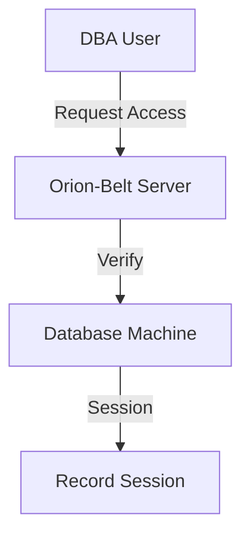

# Database Maintenance

Use Orion-Belt to securely manage and maintain database servers.

---

## Scenario

A DBA needs SSH access to production databases but cannot share the root password.

---

## Steps

1. **Register DB server as agent**:

```bash
orion-belt-server agent register \
  --name prod-db-01 \
  --key "$(cat /tmp/db01.pub)" \
  --hostname 10.0.2.15 \
  --tags environment=production,role=database
```

2. **Create DBA user**:

```bash
orion-belt-server user create \
  --name dba \
  --email dba@example.com \
  --key "$(cat /tmp/dba.pub)"
```

3. **Grant access**:

```bash
orion-belt-server permission grant \
  --user dba \
  --machine prod-db-01 \
  --type ssh \
  --duration 7200
```

---

## Benefits

* No need to share system passwords.
* Access is **audited and temporary**.
* Works across multiple servers from a single client.

---

## Mermaid Diagram


