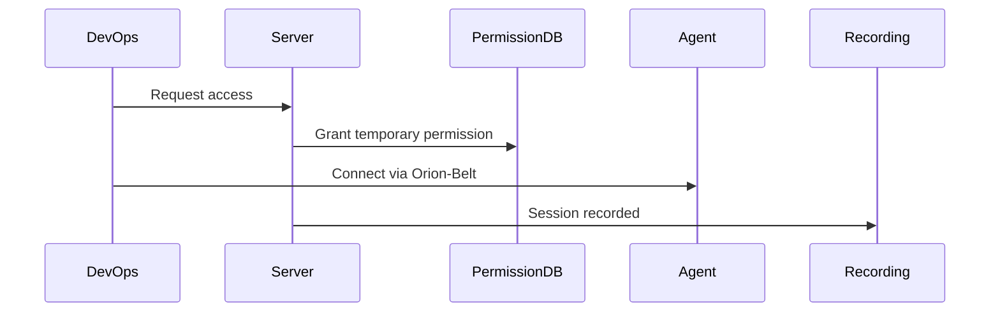

# DevOps Access

Orion-Belt simplifies DevOps workflows by centralizing access control to infrastructure.

---

## Scenario

A DevOps engineer needs to deploy updates to multiple servers, but only for a limited time and with session recording.

---

## Steps

1. **Register the servers as agents**:

```bash
orion-belt-server agent register \
  --name web-01 \
  --key "$(cat /tmp/web01.pub)" \
  --hostname 10.0.1.10 \
  --tags environment=production,role=web
```

2. **Create DevOps user**:

```bash
orion-belt-server user create \
  --name devops \
  --email devops@example.com \
  --key "$(cat /tmp/devops.pub)"
```

3. **Grant temporary access**:

```bash
orion-belt-server permission grant \
  --user devops \
  --machine web-01 \
  --type both \
  --duration 3600
```

---

## Benefits

* Temporary access reduces risk of unauthorized long-term access.
* All sessions are **recorded** for auditing.
* Access can be **revoked instantly**.

---

## Mermaid Diagram


