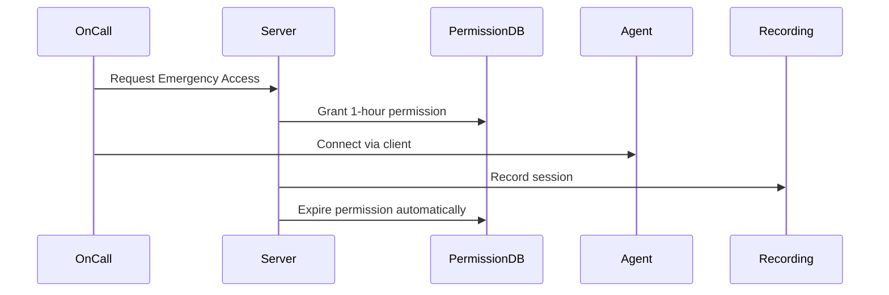

# Emergency Access

Orion-Belt enables temporary access for urgent troubleshooting.

---

## Scenario

A critical production server is down. An engineer needs immediate access.

---

## Steps

1. **Grant temporary access (1 hour)**:

```bash
orion-belt-server permission grant \
  --user oncall \
  --machine prod-web-01 \
  --type ssh \
  --duration 3600
```

2. **Connect via client**:

```bash
./osh prod-web-01 -u oncall -c /etc/orion-belt/client.yaml
```

3. **Session ends automatically** when duration expires.

---

## Benefits

* Access is **time-limited**, reducing risk.
* All emergency sessions are **audited**.
* Engineers do not need permanent server accounts.

---

## Mermaid Diagram


