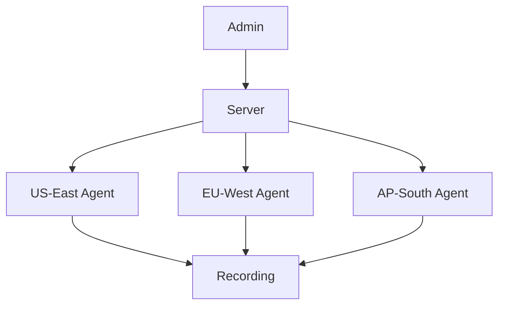

# Multi-Datacenter Access

Orion-Belt manages SSH access across multiple datacenters from a single control plane.

---

## Scenario

A company has servers in US-East, EU-West, and AP-South. Admins need controlled access to all locations.

---

## Steps

1. **Register all agents**:

```bash
orion-belt-server agent register --name us-east-web --hostname 10.0.1.10 --key "$(cat /tmp/us-east.pub)" --tags datacenter=us-east
orion-belt-server agent register --name eu-west-web --hostname 10.0.2.10 --key "$(cat /tmp/eu-west.pub)" --tags datacenter=eu-west
orion-belt-server agent register --name ap-south-web --hostname 10.0.3.10 --key "$(cat /tmp/ap-south.pub)" --tags datacenter=ap-south
```

2. **Grant access based on region**:

```bash
orion-belt-server permission grant --user admin --machine us-east-web --type both
orion-belt-server permission grant --user admin --machine eu-west-web --type both
```

---

## Benefits

* Single server controls **global access**.
* Multi-datacenter tagging allows **filtering by region**.
* Audit logs combine sessions across all locations.

---

## Mermaid Diagram


