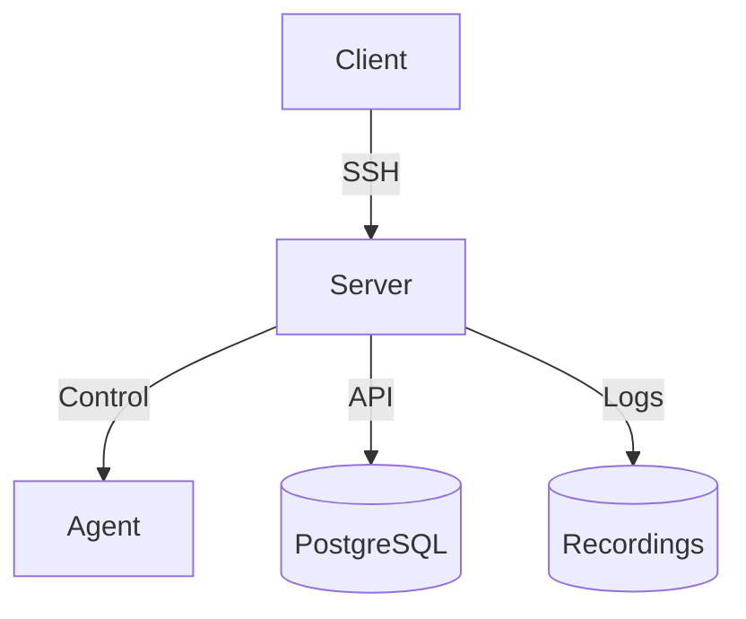

# Architecture Overview

Orion-Belt consists of three main components:

1. **Server** – Central control plane managing agents, users, and permissions.
2. **Agents** – Installed on machines to enable controlled SSH access.
3. **Clients** – Users connect through the server to reach agents.

---

## Mermaid Diagram

