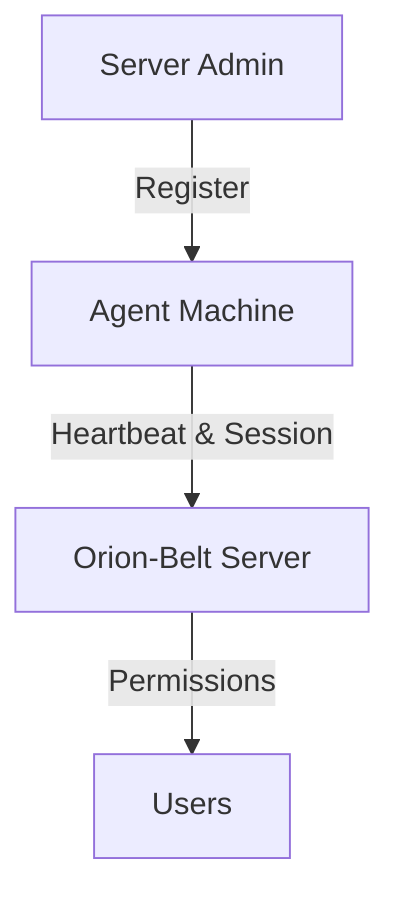

# Orion-Belt Machine (Agent) Management

This page covers **registering agents, listing, deleting, and tagging them**. An agent is any machine that can be accessed via the Orion-Belt server.

---

## Machine Lifecycle



---

## Register a Machine (Agent)

```bash
orion-belt-server agent register \
  --name web-01 \
  --key "$(cat /etc/orion-belt/agent_key.pub)" \
  --hostname 192.168.0.110 \
  --port 22 \
  --tags environment=production,role=web
```

**Notes:**

* `--key` is the agent **public key**.
* `--hostname` is the machine IP or hostname.
* `--tags` help identify environment, role, and datacenter.

**Example:**

```bash
orion-belt-server agent register \
  --name db-01 \
  --key "$(cat /etc/orion-belt/agent_key.pub)" \
  --hostname 192.168.0.111 \
  --port 22 \
  --tags environment=production,role=database,tier=backend
```

---

## List Machines

```bash
orion-belt-server agent list
```

**Output:**

```
NAME         HOSTNAME       PORT  STATUS   LAST SEEN             TAGS
----         --------       ----  ------   ---------             ----
web-01       192.168.0.110  22    online   2026-01-04 10:25:00   environment=production,role=web
db-01        192.168.0.111  22    offline  2026-01-04 09:15:30   environment=production,role=database
```

---

## Delete a Machine

```bash
orion-belt-server agent delete <agent-name>
```

**Example:**

```bash
orion-belt-server agent delete web-01
# Output: Agent 'web-01' deleted successfully.
```

---

## Tagging Machines

* Tags are **key=value pairs** used to organize machines.
* Examples:

  * `environment=production`
  * `role=web`
  * `datacenter=us-east-1`

---

## Grant Permissions to Machines

```bash
orion-belt-server permission grant \
  --user alice \
  --machine web-01 \
  --type ssh
```

**Access Types:**

* `ssh` – SSH access only
* `scp` – File transfer only
* `both` – SSH + SCP access

**Temporary access:**

```bash
orion-belt-server permission grant \
  --user bob \
  --machine db-01 \
  --type both \
  --duration 3600  # seconds
```

---

## FAQ

* **Do I need to register an agent for every machine?**
  Yes, each machine must be registered to accept connections.

* **What happens if the agent goes offline?**
  Connections are queued; the server logs the last seen timestamp.

* **Can I tag machines for easier access control?**
  Yes, tags can be used to filter machines when granting permissions.


