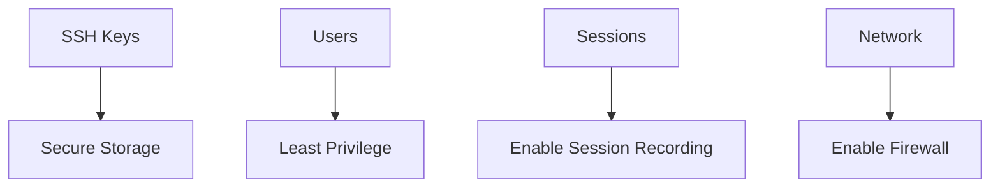

# Security Best Practices

Follow these guidelines to ensure a secure Orion-Belt deployment.

---

## 1. Key Management

- Use **unique SSH keys** per agent and user.  
- Never share private keys.  
- Rotate keys periodically.

---

## 2. User & Permission Management

- Use **least privilege** principles.  
- Grant access only to required machines.  
- Prefer temporary access when possible.

---

## 3. Session Recording

- Enable session recording for all SSH connections.  
- Retain logs for at least 90 days.  
- Store recordings in a secure directory with proper permissions.

---

## 4. Network Security

- Limit server port (default 2222) to trusted IP ranges.  
- Use TLS/HTTPS for API endpoints.  
- Enable firewall rules on server and agents.

---

## 5. Regular Updates

- Keep Orion-Belt binaries updated.  
- Regularly update system packages.  
- Monitor security advisories.

---

## 6. Mermaid Diagram

---

## 7. FAQ

**Q: Can I use LDAP or SSO?**
Currently Orion-Belt uses local user management with SSH keys. SSO integration may be added in future versions.

**Q: How to rotate keys safely?**
Register new keys on the server before removing old ones from agents/users.
