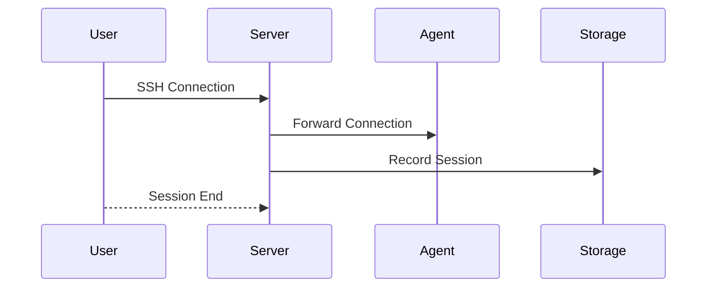

# Session Recording

Orion-Belt can record all SSH sessions for audit and compliance.

---

## 1. Enable Recording

In server.yaml:

```yaml
session:
  recording:
    enabled: true
    storage: /var/lib/orion-belt/recordings
    retention_days: 90
```

* `enabled` → true/false
* `storage` → directory for recordings
* `retention_days` → number of days to keep recordings

---

## 2. View Active Sessions

```bash
orion-belt-server session list
```

**Output:**

| USER  | MACHINE | START TIME       | DURATION |
| ----- | ------- | ---------------- | -------- |
| alice | web-01  | 2026-01-09 10:30 | 5m30s    |

---

## 3. Mermaid Diagram



---

## 4. FAQ

**Q: How long are recordings kept?**
Set in `retention_days`. Server automatically purges old recordings.

**Q: Can recordings be disabled?**
Yes, set `enabled: false` in the config.

**Q: Where are recordings stored?**
Default: `/var/lib/orion-belt/recordings`
