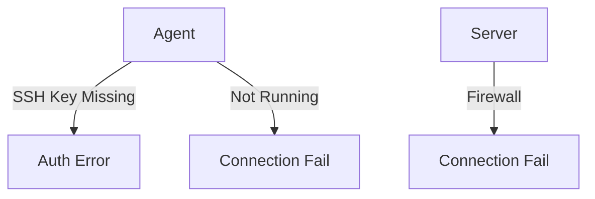

# Troubleshooting

Common issues with Orion-Belt server, agents, and clients.

---

## 1. Connection Issues

**Error:** `no route to host`

- Verify network connectivity between server and agent.  
- Check firewall rules on both server and agent.

---

**Error:** `SSH authentication failed`

- Ensure public key of agent is registered on the server.  
- Ensure client key is valid and exists on disk.

---

## 2. Agent Offline

- Check agent service:

```bash
sudo systemctl status orion-belt-agent
sudo systemctl restart orion-belt-agent
```

* Ensure server can reach the agent's hostname and port.

---

## 3. Common Logs

* Server logs: `/var/log/orion-belt/server.log`
* Agent logs: `/var/log/orion-belt/agent.log`
* Check logs for errors on startup or connection failures.

---

## 4. Mermaid Diagram



---

## 5. FAQ

**Q: Why can't the client connect?**

* Client must use correct username and key.
* Machine must exist and be online in server registry.

**Q: What if server crashes?**

* Restart server: `sudo systemctl restart orion-belt-server`
* Check logs for root cause.
