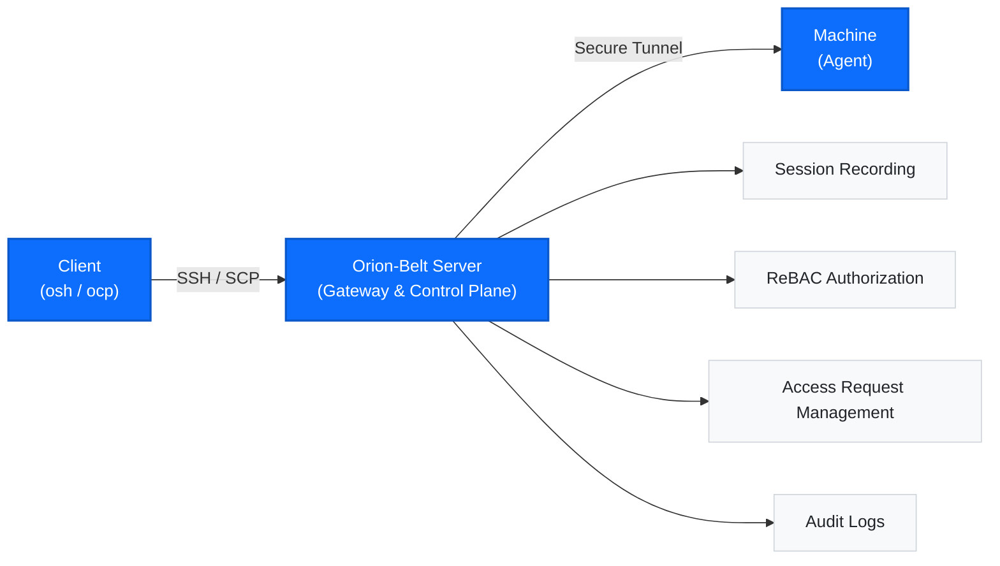

# Orion-Belt Documentation

**Orion-Belt** is an open-source, secure SSH/SCP bastion system designed for **controlled access to infrastructure without exposing networks**.

It provides **reverse SSH tunneling**, **relationship-based access control (ReBAC)**, **temporary access workflows**, and **full session recording**, making it ideal for teams that need **auditable, time-bound, and approval-based access** to servers behind firewalls.

Think of it as a lightweight, self-hosted alternative to traditional bastion hosts or commercial access gateways — built with simplicity, auditability, and extensibility in mind.

:::info What is Orion-Belt?

Orion-Belt acts as a gateway between users and your target machines, providing authentication, authorization, session recording, and comprehensive audit logging for all SSH connections.

:::

## Why Orion-Belt?

Traditional SSH and VPN-based access have limitations:

- Long-lived credentials
- No native approval workflow
- Limited auditability
- Broad network access instead of per-machine access

Orion-Belt solves this by:
- Eliminating inbound firewall rules using **reverse SSH tunnels**
- Enforcing **fine-grained, relationship-based access control**
- Supporting **temporary, approval-based access**
- Recording **every session for audit and replay**
- Acting as a single, centralized access gateway

## Key Features

- **Server Mode**: SSH/SCP tunneling server with session recording
- **Client Mode**: CLI tools (osh, ocp) for connecting to machines through the server
- **Agent Mode**: Runs on target machines to receive connections
- **ReBAC**: Relationship-based access control for authorized users
- **Temporary Access**: Request-based temporary access with admin approval
- **Session Recording**: Complete session recording and audit trails
- **Plugin System**: Extensible plugin architecture
- **Database Agnostic**: Interface-based database layer for easy switching

## Architecture

## How It Works

Orion-Belt consists of three main components working together:

1. **Server** — The central control plane that manages authentication, authorization, and configuration. All requests flow through the server.
2. **Agent** — Deployed on or near target machines, agents handle the actual SSH connections and session recording. Multiple agents can connect to a single server.
3. **Client (osh)** — The command-line tool users interact with. It authenticates with the server and establishes connections through the appropriate agent.
Get started by **creating a new site**.

Or **try Docusaurus immediately** with **[docusaurus.new](https://docusaurus.new)**.

### Who Should Use Orion-Belt?

Orion-Belt is designed for organizations that need:

- Compliance with SOC 2, HIPAA, PCI-DSS, or similar frameworks
- Centralized SSH access management across multiple environments
- Complete audit trails of infrastructure access
- Secure temporary access for contractors or on-call engineers
- Break-glass procedures for emergency situations

## Getting Started

Ready to deploy Orion-Belt? Head to the Quickstart section to install and configure your first server and agent. The process takes about 15 minutes for a basic setup.

