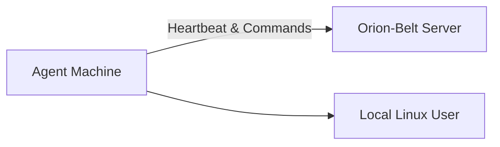

# Orion-Belt Agent Setup

Agents run on target machines and connect to the Orion-Belt server. Each agent requires a **local Linux user** that matches the client connecting.

---

## Architecture Overview



---

## Installation Steps

1. **Install Dependencies:**

```bash
sudo apt update
sudo apt install -y curl openssh-client tar
```

2. **Create Directories:**

```bash
sudo mkdir -p /opt/orion-belt/bin /etc/orion-belt /var/lib/orion-belt/recordings /var/log/orion-belt
sudo chmod -R 755 /opt/orion-belt /etc/orion-belt /var/lib/orion-belt /var/log/orion-belt
```

3. **Generate Agent Key (for server authentication):**

```bash
ssh-keygen -t ed25519 -f /etc/orion-belt/agent_key -N ""
```

4. **Copy Binary to Agent Machine:**

```bash
cp orion-belt-agent /opt/orion-belt/bin/
chmod +x /opt/orion-belt/bin/orion-belt-agent
```

5. **Create Agent Configuration:** `/etc/orion-belt/agent.yaml`

```yaml
server:
  host: "192.168.0.109"
  port: 2222

agent:
  name: "agent01"
  tags:
    environment: "production"
    role: "web"
    datacenter: "us-east-1"

auth:
  key_file: "/etc/orion-belt/agent_key"
```

6. **Start Agent:**

```bash
nohup /opt/orion-belt/bin/orion-belt-agent --config /etc/orion-belt/agent.yaml \
    > /var/log/orion-belt/agent.log 2>&1 &
```

---

## Register Agent on Server

```bash
orion-belt-server agent register \
  --name agent01 \
  --key "$(cat /etc/orion-belt/agent_key.pub)" \
  --hostname 192.168.0.110 \
  --port 22 \
  --tags environment=production,role=web
```

---

## FAQ

* **Do I need a Linux user for each client?**
  Yes, clients connect via a local Linux user mapped to their username.

* **Do I use private or public keys in config?**

  * Agent config uses **private key** (`agent_key`) to authenticate to the server.
  * Server receives **public key** (`agent_key.pub`) during registration.