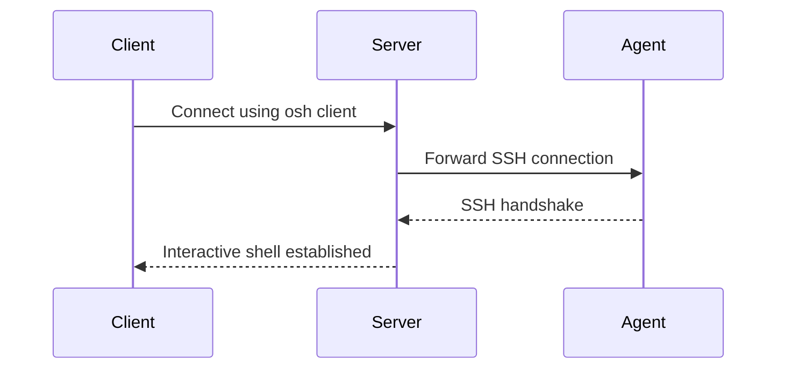

# Initial Connection: Agent to Server

After installing the Orion-Belt **server** and **agent**, the next step is to establish the first connection. This ensures that the server can manage the agent, and users can connect through the Orion-Belt gateway.

---

## 1. Overview

The initial connection process consists of:

1. **Generating SSH keys** on the agent.  
2. **Copying the public key to the server**.  
3. **Registering the agent** on the server.  
4. **Testing connectivity** from client to agent via the server.


---

## 2. Generate SSH Key on Agent

Each agent machine needs its **unique SSH key**. On the agent:

```bash
# Switch to root or use sudo
sudo su -

# Generate an Ed25519 key for Orion-Belt agent
ssh-keygen -t ed25519 -f /etc/orion-belt/agent_key -N ""
```

This will create:

* Private key: `/etc/orion-belt/agent_key`
* Public key: `/etc/orion-belt/agent_key.pub`

> **Important:** Never share the private key. Only the server needs the public key.

---

## 3. Copy Public Key to Server

The server needs the agent's public key to authenticate it.

```bash
# On agent machine
scp /etc/orion-belt/agent_key.pub server_user@server_ip:/tmp/agent_key.pub
```

> Replace `server_user` and `server_ip` with your server's username and IP address.

---

## 4. Register Agent on Server

On the server:

```bash
# Register the agent
orion-belt-server agent register \
  --name agent-01 \
  --key "$(cat /tmp/agent_key.pub)" \
  --hostname 192.168.0.102 \
  --port 22 \
  --tags environment=production,role=web
```

**Explanation of parameters:**

* `--name` → Unique name for the agent in the Orion-Belt system.
* `--key` → Agent's public key.
* `--hostname` → The agent's IP or hostname reachable by the server.
* `--port` → SSH port of the agent (default `22`).
* `--tags` → Metadata to identify the agent (optional).

**Expected output:**

```
Agent registered successfully:
  Name:       agent-01
  Machine ID: uuid-xxxx-xxxx
  Hostname:   192.168.0.102
  Port:       22
```

---

## 5. Verify Agent Connectivity

After registration, start the agent service on the agent machine:

```bash
sudo systemctl start orion-belt-agent
sudo systemctl enable orion-belt-agent
```

On the server, check agent status:

```bash
orion-belt-server agent list
```

**Output example:**

```
NAME       HOSTNAME       PORT  STATUS   LAST SEEN
agent-01   192.168.0.102 22    online   2026-01-09 12:30:00
```

---

## 6. Test Connection from Client

From a client machine:

```bash
osh agent-01 -u client -c /etc/orion-belt/client.yaml
```

* `-u client` → Orion-Belt username.
* `-c` → Path to the client configuration.

> If successful, you should see an interactive shell connected to the agent via the server.

---

## 7. Common Issues & FAQ

### ❌ `Connection failed: no route to host`

* Ensure agent hostname/IP is reachable from the server.
* Check firewall rules allowing port `22` or the custom SSH port.

### ❌ `User client does not exist on agent`

* Create the same user on the agent machine that matches the Orion-Belt username.

```bash
sudo adduser client
```

### ❌ `SSH authentication failed`

* Ensure the **private key exists** on the agent at `/etc/orion-belt/agent_key`.
* Ensure the public key was registered correctly on the server.

---

## 8. Notes

* Each agent must have a **unique SSH key**.
* Server stores only the **public key**.
* Tags help with filtering agents and grouping machines for access policies.



---

**Next Steps:**

* Add users and grant permissions using **User Management** guide.
* Start recording sessions for compliance (see **Session Recording** guide).
* Automate agent registration for multiple machines.
