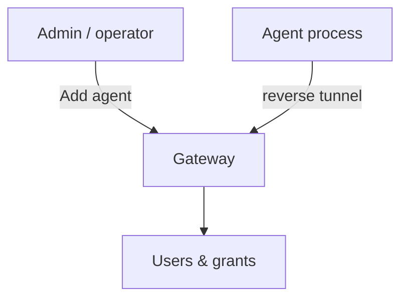

# Machine (agent) management

An **agent** is a target machine enrolled with Orion Belt. Agents dial **out** to the gateway; you manage them primarily from the web console.



## Add an agent (recommended)

1. Console → **Add agent**
2. Choose OS, name, gateway host (port **2222**), package base URL
3. **Generate install script** → run as root on the target  
   or save the private key and run the [Docker agent](../quickstart/agent)

Connected agents appear under **Agents**.

## Register without the install script

1. Generate a key on the target:  
   `ssh-keygen -t ed25519 -f /etc/orion-belt/agent_key -N ""`
2. Register the **public** key (UI, API `POST /api/v1/public/register/agent`, or `orion-belt-server agent register`)
3. Start `orion-belt-agent` (systemd or Docker)

With **SSH CA** enabled, registration may return a Host certificate — see main repo `docs/SSH_CA.md`.

## List / status

- UI **Agents** — online/offline, last seen
- CLI: `orion-belt-server agent list` (when using the server CLI on the gateway host)

## Remove an agent

- UI: remove/deregister the machine, then stop the agent service on the host
- CLI: `orion-belt-server agent delete <name>` (if available in your build)

Stop and wipe `/etc/orion-belt/agent_key` on the host after removal.

## Tags & grants

Use tags/metadata for grouping. Access is still **per user ↔ machine** (and remote users) via **Permissions** / grants — tagging alone does not grant SSH.

```bash
orion-belt-server permission grant \
  --user alice --machine web-01 --type both --remote-users root
```

## FAQ

**Why is my agent offline?**  
It can’t reach the gateway on **2222**, wrong name/key, or the process isn’t running. The gateway does not dial inbound to the agent.

**Can one gateway serve many agents?**  
Yes — that’s the normal model.
