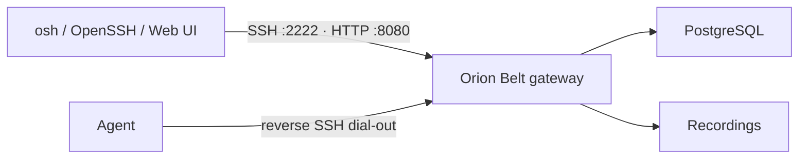

# Server (gateway) setup

The **Orion Belt server** is the control plane: SSH/SCP proxy, HTTP API, web console, authz, recording, and agent tunnels.

:::tip Lab first?
Use **[Try in 10 minutes](./try-in-10-minutes)** (`./scripts/docker-quickstart.sh`). This page covers durable / production-shaped setups.
:::



## Option A — Docker

From a clone of [orion-belt](https://github.com/orion-belt-dev/orion-belt):

```bash
./scripts/docker-quickstart.sh
# or manually:
cp .env.server.example .env.server
# set POSTGRES_PASSWORD and ORION_JWT_SECRET (openssl rand -hex 32)
docker compose -f docker-compose.server.yml --env-file .env.server up -d
```

Ports:

| Port | Role |
| --- | --- |
| **2222** | SSH gateway (clients + agents) |
| **8080** | HTTP API + web console `/ui` |

Bootstrap the first admin (SSH public-key auth — no browser signup):

```bash
ssh-keygen -t ed25519 -f admin-key -N ""
docker compose -f docker-compose.server.yml --env-file .env.server exec -T \
  -e ORION_SETUP_ADMIN_NAME=admin \
  -e ORION_SETUP_ADMIN_EMAIL=admin@localhost \
  -e ORION_SETUP_ADMIN_KEY="$(cat admin-key.pub)" \
  server /app/orion-belt-server -c /etc/orion-belt/config.generated.yaml setup
```

Sign in via a bootstrap link from `./bin/osh -c client.yaml login` (or the link printed by `docker-quickstart.sh`), then set a password + TOTP.

Optional env (see `.env.server.example`): `ORION_WEBAUTHN_ENABLED`, `ORION_PUBLIC_HOST` / `ORION_PUBLIC_ORIGIN`, `ORION_RECORDING_ENCRYPTION_KEY`, `ORION_MFA_REQUIRED`.

## Option B — Packages / systemd

1. Install the `orion-belt` package (deb/rpm/apk — see the main repo `docs/PACKAGING.md`).
2. Edit `/etc/orion-belt/server.yaml` — at least:
   - `database.connection_string`
   - `auth.jwt_secret` (long random; not the example value)
3. Diff against `config/server.example.yaml` in the repo for MFA, WebAuthn, SSH CA, recording encryption, OpenFGA, retention.
4. Start:

```bash
sudo systemctl enable --now orion-belt-server
```

5. First admin:

```bash
sudo -u orionbelt orion-belt-server -c /etc/orion-belt/server.yaml setup
# or non-interactive:
export ORION_SETUP_ADMIN_NAME=admin
export ORION_SETUP_ADMIN_EMAIL=admin@example.com
export ORION_SETUP_ADMIN_KEY_FILE=/path/to/admin.pub
orion-belt-server -c /etc/orion-belt/server.yaml setup
```

UI: `http://<host>:8080/ui`

```bash
curl -s http://localhost:8080/api/v1/version
orion-belt-server --version
```

## Important ports & reachability

- **Expose** the gateway’s **2222** (and usually **8080**/HTTPS) to operators and agents.
- **Do not** require inbound SSH on target hosts — agents dial **out** to the gateway on 2222.

## Next

1. [Agent setup](./agent)  
2. [Client / connect](./client)  
3. [Initial connection checklist](./initial-connection)
